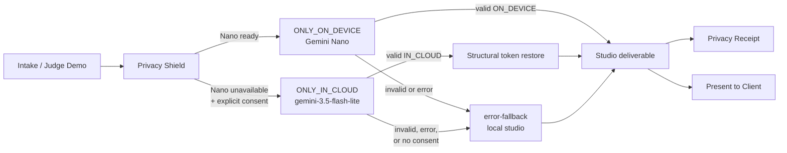

# Atelier Brief

A quiet-luxury website briefing studio for independent practices. Atelier Brief turns a client intake into a structured brief, an interactive sitemap, art direction, and design-decision rationale — and it treats **on-device inference as a privacy feature**, not a novelty toggle.

**Positioning:** The AI design studio that knows when client information should stay on your device.

Built for [#BuildHybridAI 2026](https://firebasehybridaihackathon.devpost.com/) with the official [Firebase AI Logic](https://firebase.google.com/docs/ai-logic/hybrid/web/get-started) hybrid web SDK (`firebase@13.4.0`).

**Live demo:** https://atelier-brief-ai.web.app (Firebase Hosting, Spark plan). The public build runs in Studio Preview until a Firebase AI Logic web config is added.

**Live path:** Firebase **Spark** free tier only. Never enable Blaze. Never call billed image-generation models.

## Why hybrid inference is the product

Freelance briefs contain names, budgets, contacts, and notes a studio should not casually ship to the cloud. When Chrome Built-in AI (Gemini Nano, Chrome 139+) is available, Atelier Brief **awaits** `initializeDeviceModel()` and then uses `InferenceMode.ONLY_ON_DEVICE`. If Nano is missing, **Privacy Shield** tokenizes confidential fields *before* any `ONLY_IN_CLOUD` call, and only after the user explicitly approves redacted cloud fallback. Tokens are restored with a recursive walk over parsed JSON (quotes, backslashes, newlines, and Unicode are safe). Invalid model JSON is never backfilled and never badged as a successful AI result.

Honest inference badges:

| Status | Label | When it is shown |
| --- | --- | --- |
| `on-device` | On-Device · Gemini Nano | `inferenceSource === ON_DEVICE` and the payload passes strict schema validation |
| `cloud` | Cloud Fallback · Firebase AI Logic | `inferenceSource === IN_CLOUD` and validation passes |
| `error-fallback` | Local Fallback · AI Call Failed | A real AI call was attempted and failed, or the response failed validation |
| `preview` | Studio Preview · Deterministic Non-AI | No Firebase web config is present |

## Architecture



```
src/lib/hybridAi.ts        Official firebase/app, firebase/app-check, firebase/ai
src/lib/privacyShield.ts   Full-prompt redaction + structural restore
src/lib/validateBundle.ts  Strict schema validation (no silent backfill)
src/lib/privacyReceipt.ts  Per-session Privacy Receipt
src/lib/localStudio.ts     Deterministic Studio Preview composer
src/lib/persistence.ts     IndexedDB + localStorage archive (local, not E2E encrypted)
src/components/            Editorial workspace, drawers, sitemap studio, presentation
```

### Firebase AI Logic request flow

1. Read public Spark web config from gitignored `.env.local`. If missing, compose a deterministic preview and badge `preview`.
2. Initialize `getAI(app, { backend: new GoogleAIBackend() })` and three official models: `PREFER_ON_DEVICE`, `ONLY_ON_DEVICE`, `ONLY_IN_CLOUD`.
3. After the user clicks Generate, await `model.initializeDeviceModel()` before any `ONLY_ON_DEVICE` request.
4. Read `result.response.inferenceSource` (`ON_DEVICE` | `IN_CLOUD`, SDK v12.5.0+). Badge success only when the source matches the path and `validateBundle()` passes.
5. Cloud prompts are always tokenized. Confidential fields require an explicit consent toggle. Sensitive prompts are never written to `console.*`.

Default cloud text model: **`gemini-3.5-flash-lite`** — official Gemini Developer API workhorse, stable, **billing not required** ([Firebase AI Logic models](https://firebase.google.com/docs/ai-logic/models)). `gemini-2.5-flash-lite` is listed as being replaced by `gemini-3.5-flash-lite`; do not switch to billed image models.

### Privacy Shield tokenization

Configured confidential fields (project, client, industry, budget, timeline, goal, audience, notes) plus detected emails and phone numbers are replaced with reversible placeholders such as `[CLIENT_NAME]`, `[BUDGET_RANGE]`, `[CONTACT]`, and `[PROPRIETARY_NOTES]`. Restoration walks objects, arrays, and strings — it does **not** `JSON.stringify` → replace → `JSON.parse`.

This redacts configured fields and detected emails/phones before cloud transmission. It does **not** guarantee full anonymization of arbitrary free-text context.

### Chrome 139+ / Gemini Nano

On-device inference requires a Chromium browser that exposes the Built-in AI `LanguageModel` API (Chrome 139+ with Gemini Nano available or downloadable). The Hybrid AI Inspector reports availability, download/init progress, and whether `initializeDeviceModel()` completed. If Nano is unavailable, the studio stays useful and will only call the cloud after consent when confidential fields exist.

### App Check

Official guidance (late 2026): **“You should use reCAPTCHA Enterprise for new integrations, and we strongly recommend that developers of apps using reCAPTCHA v3 upgrade when possible.”** Enterprise includes 10,000 assessments/month at no cost. `ReCaptchaV3Provider` remains documented and is supported via `VITE_FIREBASE_APPCHECK_PROVIDER=v3`.

The official debug hook `self.FIREBASE_APPCHECK_DEBUG_TOKEN = true` is honored **only** when `import.meta.env.DEV` is true. Production builds ignore `VITE_FIREBASE_APPCHECK_DEBUG`, so a debug token cannot ship in a Spark Hosting deploy. Never commit a token string.

## Offline Studio Preview

If no `VITE_FIREBASE_*` keys are present, the full interface still runs: The Aster Hotel judge demo, composition, sitemap studio, art-direction specimen, Privacy Receipt, presentation mode, export, and local persistence. The UI is clearly labelled Studio Preview, and no cloud request is implied. Hybrid inference starts once a Spark web config is provided and the app is rebuilt.

## $0 Spark setup

1. Create a Firebase project and **leave it on the Spark plan**. Do not upgrade to Blaze.
2. Register a **Web** app and copy the public config values into a gitignored `.env.local` (see `.env.example`).
3. Enable **Firebase AI Logic** (Gemini Developer API). Text inference with `gemini-3.5-flash-lite` does not require billing.
4. Enable **App Check** with **reCAPTCHA Enterprise** (recommended) or reCAPTCHA v3. Put the public site key in `VITE_FIREBASE_RECAPTCHA_SITE_KEY`.
5. For local development only, set `VITE_FIREBASE_APPCHECK_DEBUG=true` in `.env.local`. Register the console-printed debug token in Firebase Console → App Check → Manage debug tokens. **Never commit the token.**
6. The first time a Google account uses Firebase, accept the [Firebase Terms of Service](https://firebase.google.com/terms) in the console ([forceCheckTos](https://console.firebase.google.com/?forceCheckTos=true)). Official docs state this cannot be done via CLI, REST, or Terraform.
7. Build and deploy with Firebase Hosting on Spark:

```bash
cp .env.example .env.local   # then fill values
npm install
npm test                     # unit tests
npm run dev                  # local studio
npm run build
npm run preview
npm run test:e2e             # Playwright against the production preview
npx -y firebase-tools@latest deploy --only hosting
```

Target project: `atelier-brief-ai` (no billing account; Spark only). Live URL: https://atelier-brief-ai.web.app

Official debug-token guidance: [Use App Check with the debug provider in web apps](https://firebase.google.com/docs/app-check/web/debug-provider).

## Standout features (all $0)

1. **Privacy Receipt** — per-session receipt stored with the project in IndexedDB (session id, verified source, model, protected-field count, whether cloud ran, redacted preview, honest scope). Exportable.
2. **Sitemap Studio** — hierarchical tree (CSS Grid + nested components, no graph library): expand/collapse, inline titles, add/remove/reorder, priority pages, conversion goals.
3. **Art Direction Specimen** — live typography specimen, color-study swatches (click to copy hex), one-click **Copy CSS Variables**.
4. **Design Decisions** — `DESIGN DECISION / 01` cards (recommendation, reasoning, business objective, implementation) from the same schema.
5. **Present to Client** — one click or `?presentation=1` hides the sidebar, inspector, and confidential notes (opt-in to reveal), then prints a cover + brief + sitemap + art direction.

One-click **Load sample project** loads a realistic fictional hospitality brief, including quotes (`Maison "JJ" Aster & Co.`), contacts, budget, and private notes, so judges can inspect redaction and restoration immediately.

## Scripts and tests

```bash
npm test           # Node test runner (Privacy Shield, schema, telemetry badges)
npm run test:e2e   # Playwright: Aster Hotel demo, inspector, receipt, sitemap, specimen, export, delete, presentation, mobile
npm run build      # TypeScript + production bundle
```

## Honest limitations

- Studio Preview is deterministic and non-AI. It is for review without Firebase config, not a substitute for a live Nano or cloud call.
- IndexedDB / localStorage is **local browser storage, not end-to-end encryption**. Delete Project removes the record from this browser only.
- Privacy Shield covers configured confidential fields and detected emails/phones. It does not claim complete anonymization of free-text context.
- On-device inference depends on the visitor’s Chrome/Nano availability.
- This repository never contains Firebase API secrets or App Check debug tokens (`.env.local` is gitignored; production builds ignore the debug flag).

## License

MIT © 2026 Sri Wahyuni (yunnaysy)

Display and interface fonts bundled under `public/fonts` are licensed under the SIL Open Font License (see the OFL text files in that folder): Instrument Serif, DM Sans, and IBM Plex Mono.
